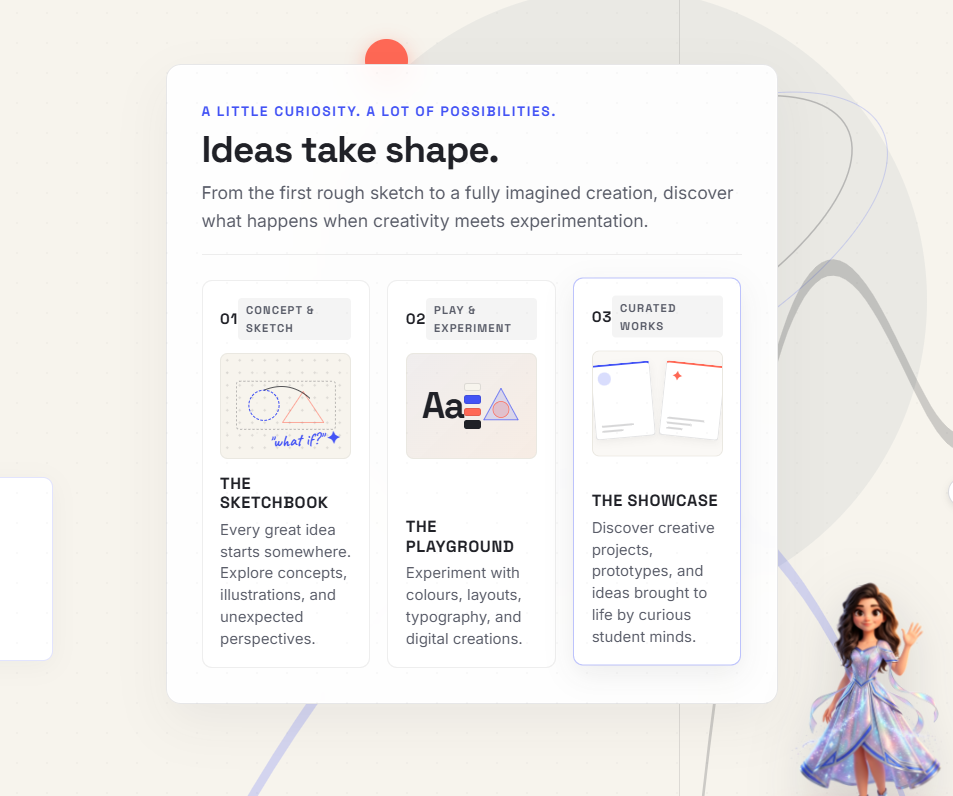
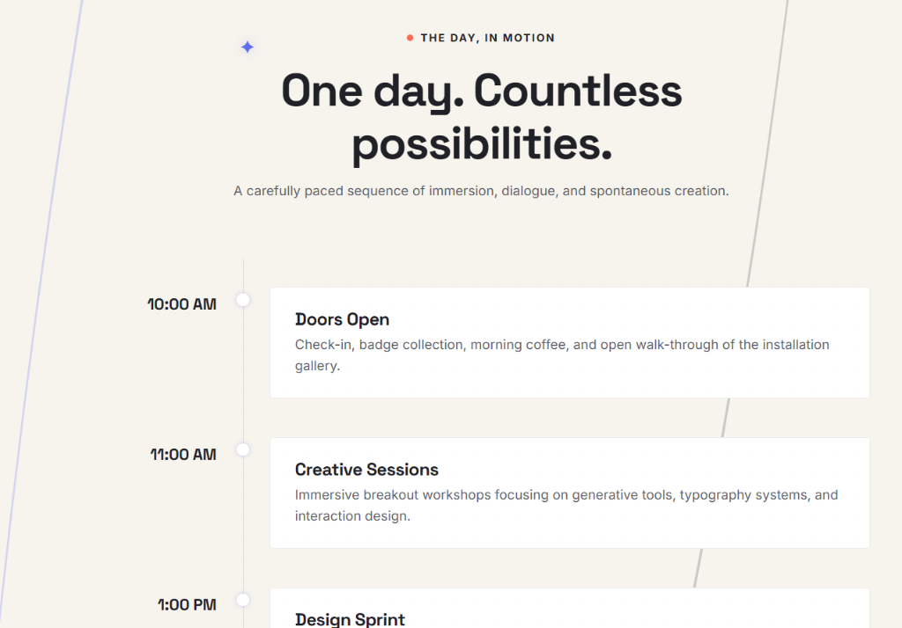
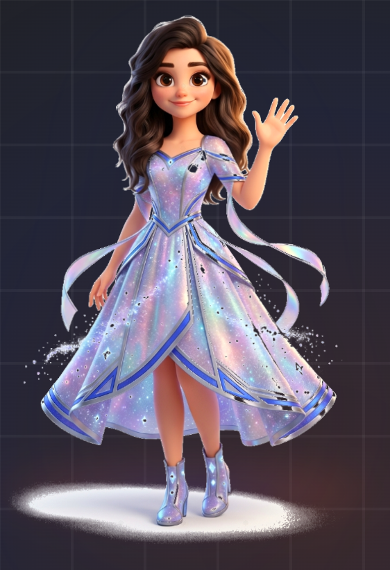

# DesignVerse — Student Design & Innovation Fest

A responsive, editorial frontend landing page for a premier student festival celebrating design, creativity, experimentation, and emerging technology.

---

## Visuals & Feature Highlights

### 1. Hero & Creative Identity

*Editorial near-future creative identity featuring modern typography, event metadata ribbon, and futuristic student designer concept art.*

### 2. "Ideas Take Shape" Creative Showcase

*Interactive 3-panel creative showcase spotlighting The Sketchbook (01), The Playground (02), and The Showcase (03) with live floating companion presence.*

### 3. Interactive Schedule Timeline

*Chronological event timeline featuring Saturday, 14 November 2026 (10:00 AM – 6:00 PM IST), interactive nodes, and detailed milestones.*

### 4. Live Companion Mascot — Nova
<p align="center">
  
</p>

*Interactive 3D starlight companion featuring real-time collision-free screen docking, debounced section dialogues, multi-pose kinematics (standing, sitting on a holographic ring, cheering, thinking, waving), and particle sparkles.*

---

## Features

- **Editorial Hero & Event Overview**: Headline layout with event metadata (Date, Time, Venue) and dual call-to-actions.
- **"Ideas Take Shape" Showcase**: 3-panel creative experience spotlight covering The Sketchbook, The Playground, and The Showcase.
- **About & Festival Principles**: Highlights the core philosophy—*Think Differently*, *Experiment Fearlessly*, and *Make It Real*.
- **Curated Experiences Grid**: Breakdown of festival workshops and activities across Interaction Design, Physical Computing, Visual Systems, and Bio-Inspired Media.
- **Interactive Schedule Timeline**: Chronological event schedule detailing doors open (10:00 AM), creative labs, open studio exhibition, and awards.
- **Front-End Registration UI (Demo)**: Client-side registration form with ticket type selector (Student, Group, Virtual), input validation, and an interactive digital pass preview modal. *(Demonstration only; no server-side backend or database)*.
- **Live Animated Mascot Companion ("Nova")**: An interactive 3D-styled companion with continuous multi-pose body animations (standing, sitting, cheering, thinking, waving, twirling), automatic collision-free screen placement, contextual reactions to user clicks and sections, concise remarks, and click sparkles.

---

## Tech Stack

- **HTML5**: Semantic document structure and SVG illustrations
- **CSS3**: Custom design system, CSS grid, flexbox, CSS variables, and fluid typography
- **JavaScript (Vanilla ES6+)**: Client-side interactions, modal management, form validation, and animations (zero external framework dependencies)
- **Google Fonts**: Space Grotesk, Inter, and Caveat

---

## Getting Started

This is a pure frontend project with no external package dependencies or build steps required.

### 1. Clone or Download the Repository
Open the project directory in your terminal or editor:
```bash
git clone https://github.com/COOKEE-MJ/DesignVerse.git
cd DesignVerse
```

### 2. Run the Website Locally
You can open `index.html` directly in any web browser, or serve it using a local static server:

**Using Python:**
```bash
python -m http.server 8085
```
Then visit: `http://localhost:8085`

**Using Node.js (`npx serve`):**
```bash
npx serve .
```

---

## Project Preview

*Live Demo*: [https://your-live-demo-link.com](https://your-live-demo-link.com) *(Optional placeholder — update with your live deployment URL)*

---

## Author

- **Author**: COOKEE-MJ
- **GitHub**: [https://github.com/COOKEE-MJ](https://github.com/COOKEE-MJ)
