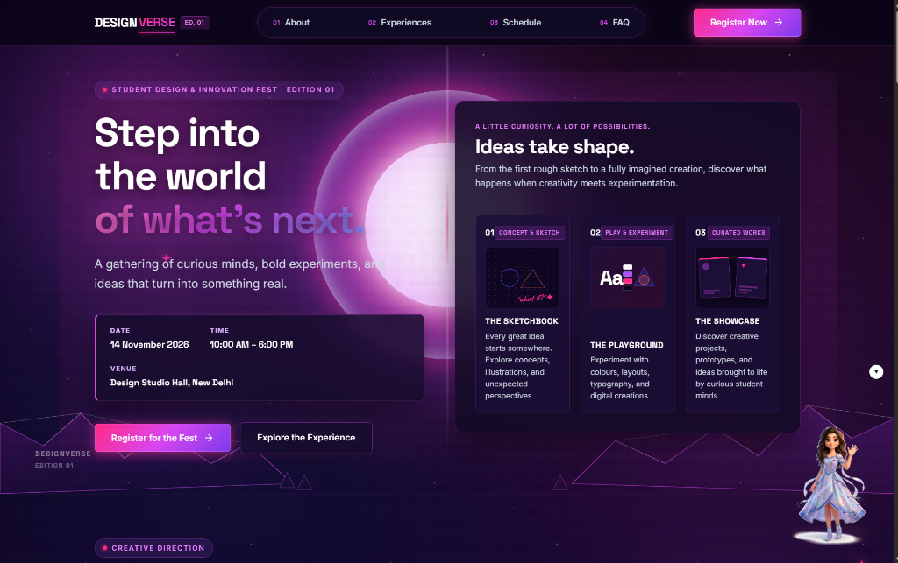
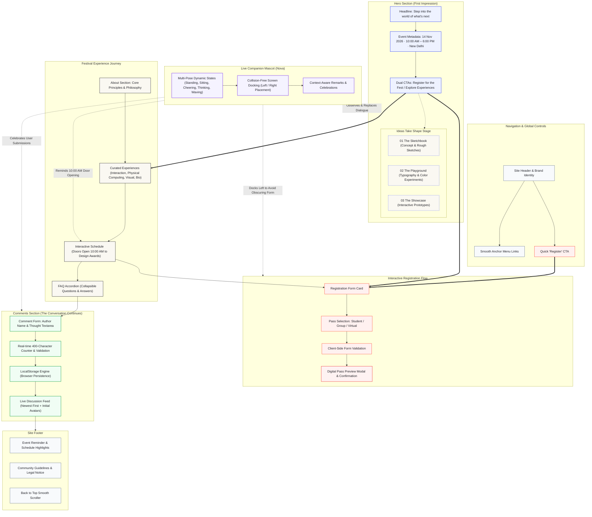

# DesignVerse — Student Design & Innovation Fest

A responsive, editorial frontend landing page for a premier student festival celebrating design, creativity, experimentation, and emerging technology.

🌐 **Live Website**: [https://cookee-mj.github.io/DesignVerse/](https://cookee-mj.github.io/DesignVerse/)

---

## 📸 Preview



---

## Website Architecture & User Flow



---

## Features

- **Editorial Hero & Event Overview**: Clean typographic hierarchy with date/time ribbon (`14 November 2026 · 10:00 AM – 6:00 PM IST`) and dual calls to action.
- **"Ideas Take Shape" Showcase**: 3-panel creative experience card spotlighting The Sketchbook (01), The Playground (02), and The Showcase (03).
- **About & Festival Principles**: Highlights core values—*Think Differently*, *Experiment Fearlessly*, and *Make It Real*.
- **Curated Experiences Grid**: Multidisciplinary tracks covering Interaction Design, Physical Computing, Visual Systems, and Bio-Inspired Media.
- **Interactive Schedule Timeline**: Chronological event milestones detailing doors open (10:00 AM), morning keynotes, lab sprints, exhibition, and evening awards.
- **Front-End Registration UI (Demo)**: Client-side pass selection (Student, Group, Virtual), input validation, and an interactive digital pass preview modal. *(Demonstration only; no server-side backend or database)*.
- **Interactive Comments Section**: Editorial conversation feed located directly below the FAQ. Features real-time validation, dynamic character counter (max 400), initial avatar badges with generative gradients, success notifications, and local browser persistence via `localStorage`.
- **Live Companion Mascot ("Nova")**: An interactive companion with multi-pose state changes (standing, sitting on a holographic ring, cheering, thinking, waving), collision-aware side switching, debounced contextual dialogues per section, and click interactions.

---

## Tech Stack

- **HTML5**: Semantic document structure, accessible ARIA attributes, and SVG illustrations
- **CSS3**: Custom design system, CSS Grid, Flexbox, custom properties, and fluid typography
- **JavaScript (Vanilla ES6+)**: Client-side interactivity, modal controls, comment persistence, and mascot state machine (zero third-party libraries)
- **Google Fonts**: Space Grotesk, Inter, and Caveat

---

## Getting Started

This is a pure frontend project with zero external build tooling or runtime dependencies required.

### 1. Clone or Download the Repository
```bash
git clone https://github.com/COOKEE-MJ/DesignVerse.git
cd DesignVerse
```

### 2. Run the Website Locally
Open `index.html` directly in any web browser, or serve it using a local static HTTP server:

**Using Python:**
```bash
python -m http.server 8085
```
Then open: `http://localhost:8085`

**Using Node.js:**
```bash
npx serve .
```

---

## Author

- **Author**: COOKEE-MJ
- **GitHub**: [https://github.com/COOKEE-MJ](https://github.com/COOKEE-MJ)
